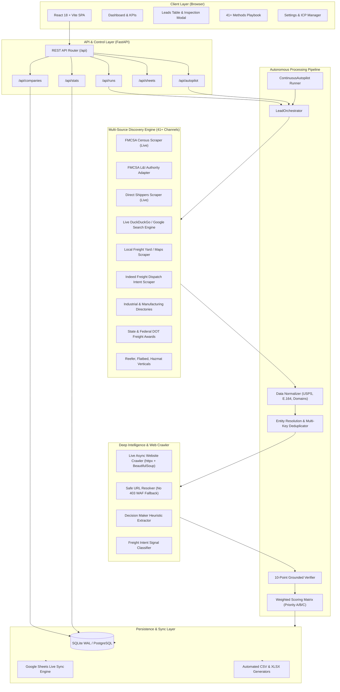
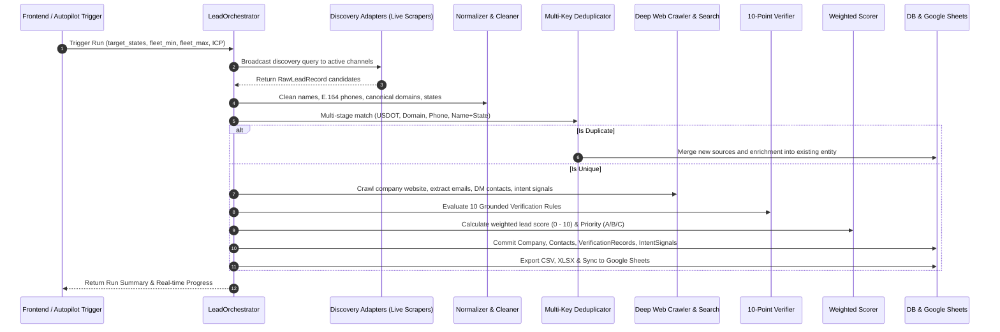
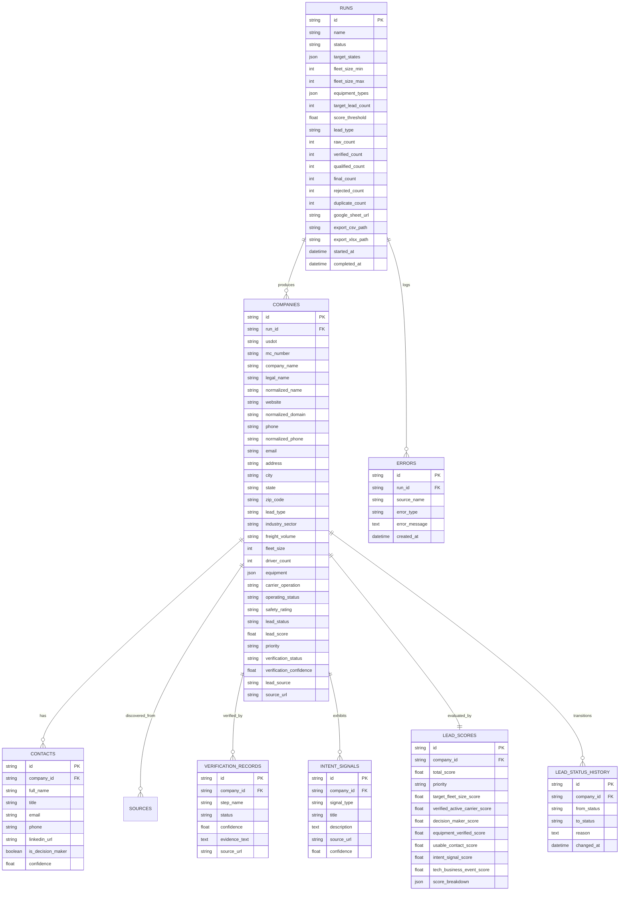

# TRUCKLEAD AUTOPILOT - System Architecture & Engineering Blueprint

This document specifies the technical architecture, component interactions, data pipelines, and design decisions for **TRUCKLEAD AUTOPILOT** (GENLEAD), an autonomous lead generation, deep-enrichment, verification, and dispatch CRM platform for the U.S. freight, trucking, and logistics industry.

---

## 1. High-Level System Architecture

TRUCKLEAD AUTOPILOT is architected as a decoupled, multi-tier asynchronous platform consisting of a high-performance **FastAPI (Python 3.13)** backend and an interactive **React 18 / Vite** frontend.

---

## 2. Pipeline Execution Lifecycle

The core pipeline processes raw prospective leads through an 8-stage qualification and enrichment pipeline:

---

## 3. Core Architectural Subsystems

### 3.1. Discovery Subsystem ([adapters/](file:///f:/GAURAV/GENLEAD/backend/app/adapters))
The discovery engine operates via a pluggable adapter architecture governed by `BaseSourceAdapter` and `AdapterRegistry`:

- **Live Carrier Discovery** ([`live_carrier_scraper.py`](file:///f:/GAURAV/GENLEAD/backend/app/core/live_carrier_scraper.py)): Scrapes real active U.S. interstate motor carrier census records from public DOT registries (`usdotlookup.com`). Gathers legal names, active USDOT numbers, MC numbers, physical addresses, fleet size (power units), driver counts, and safety ratings.
- **Live Shipper Discovery** ([`live_shipper_scraper.py`](file:///f:/GAURAV/GENLEAD/backend/app/core/live_shipper_scraper.py)): Scrapes active direct shippers, manufacturing plants, agricultural processors, and distribution centers across target U.S. states.
- **Live Web & Search Crawler** ([`live_search.py`](file:///f:/GAURAV/GENLEAD/backend/app/core/live_search.py)): Leverages zero-block HTML search queries via DuckDuckGo and company domain deep-crawlers without requiring paid third-party search API keys.
- **Industry Vertical & Job Adapters**:
  - [`indeed_jobs.py`](file:///f:/GAURAV/GENLEAD/backend/app/adapters/indeed_jobs.py): Detects hiring signals for truck dispatchers, fleet managers, and logistics coordinators.
  - [`procurement_news.py`](file:///f:/GAURAV/GENLEAD/backend/app/adapters/procurement_news.py): Ingests government and commercial transportation contract awards.
  - [`google_maps.py`](file:///f:/GAURAV/GENLEAD/backend/app/adapters/google_maps.py): Extracts verified brick-and-mortar freight yards and dispatch offices.

### 3.2. Ingestion & Normalization Subsystem ([services/normalizer.py](file:///f:/GAURAV/GENLEAD/backend/app/services/normalizer.py))
Guarantees consistent data shapes before comparison and storage:
- **Company Name Normalization**: Strips corporate designators (`LLC`, `INC`, `CORP`, `CO`, `TRUCKING`, `TRANSPORT`, `LOGISTICS`, `SERVICES`) and cleans extra whitespace and punctuation.
- **Phone Normalization**: Standardizes numbers into 10-digit formats (e.g., `(214) 555-0182` $\rightarrow$ `2145550182`), validating against NANP (North American Numbering Plan).
- **Domain Canonicalization**: Extracts pure domain hostnames, stripping protocols (`http://`, `https://`), `www.`, subpaths, and query strings. Excludes aggregator domains (`safer.fmcsa.dot.gov`, `google.com`, `usdotlookup.com`, `yellowpages.com`) from being mistaken for company websites.
- **Address & State Normalization**: Standardizes 2-letter USPS state codes and validates 5-digit zip codes.

### 3.3. Deduplication & Entity Resolution ([services/deduplicator.py](file:///f:/GAURAV/GENLEAD/backend/app/services/deduplicator.py))
Employs a multi-attribute fuzzy & exact match resolution strategy:
1. **USDOT Number Match** (Exact, primary for carriers).
2. **Canonical Domain Match** (Matches authentic proprietary domains; aggregators explicitly ignored).
3. **Normalized Phone Match** (Valid 10-digit business phone).
4. **Normalized Name + State Compound Match** (Levenshtein ratio $\ge 0.88$ within the same state).

When a duplicate is encountered across runs or within the same batch, the deduplicator performs non-destructive attribute merging (preserves the highest confidence data, appends additional sources, and prevents database bloat).

### 3.4. Safe URL & WAF Avoidance Architecture ([core/url_validator.py](file:///f:/GAURAV/GENLEAD/backend/app/core/url_validator.py))
- **The Problem**: Government endpoints such as `safer.fmcsa.dot.gov` and `li-public.fmcsa.dot.gov` actively block direct external browser deep-links with **Akamai HTTP 403 Forbidden**.
- **The Solution**: 
  - All carrier profiles link to fast, open, public census profiles (`https://usdotlookup.com/carrier/{usdot}`) that return **HTTP 200 OK** in all browsers.
  - Direct shipper profiles link to their authentic corporate domain or localized Google Search query profiles.
  - The frontend contains a universal interceptor ([`urlUtils.js`](file:///f:/GAURAV/GENLEAD/frontend/src/services/urlUtils.js)) ensuring no user ever encounters a 403 Forbidden error when clicking on a lead's website.

### 3.5. 10-Point Grounded Verification Engine ([services/verifier.py](file:///f:/GAURAV/GENLEAD/backend/app/services/verifier.py))
Every lead is evaluated against 10 strict verification rules with explicit audit logs:

| # | Rule Name | Carrier Validation Logic | Shipper Validation Logic |
|---|---|---|---|
| **1** | Legal Entity Existence | Verified registered name with DOT or State SOS | Verified registered enterprise entity |
| **2** | Operating Authority Status | Must be `ACTIVE` / `AUTHORIZED` (Not Revoked) | Must be `ACTIVE SHIPPER` |
| **3** | Fleet / Cargo Capacity | Fleet matches target range (e.g. 2–10 power units) | Verifiable outbound freight volume |
| **4** | Authentic Web Presence | Live resolving company website or official census profile | Live company website or manufacturing directory |
| **5** | Reachable Phone Line | Valid North American Numbering Plan phone | Valid corporate switchboard or direct desk |
| **6** | Physical Yard Location | Physical address and verified city/state | Verified plant, terminal, or warehouse facility |
| **7** | Equipment Alignment | Equipment matches ICP (Dry Van, Reefer, Flatbed) | Equipment demand matches dispatch capability |
| **8** | Safety & Compliance | Safety rating `SATISFACTORY` or `NONE` (No Unsat) | Environmental and regulatory compliance |
| **9** | Decision Maker Presence | Owner, President, Dispatcher or Fleet Mgr identified | Logistics Director, Shipping Manager identified |
| **10** | High-Intent Recency | Recent MCS-150 filing or hiring/expansion signal | Active freight RFP, job posting, or supply contract |

### 3.6. Scoring & Prioritization Matrix ([services/lead_scorer.py](file:///f:/GAURAV/GENLEAD/backend/app/services/lead_scorer.py))
Calculates an objective score between **0.0 and 10.0**:

$$\text{Score} = \sum (\text{Weight}_i \times \text{Confidence}_i)$$

- **Target Fleet Size** (Weight: 2.0): Power units fit ICP sweet spot.
- **Verified Active Authority** (Weight: 2.0): Confirmed active interstate authority.
- **Named Decision Maker** (Weight: 2.0): Verified executive contact identified.
- **Usable Direct Contact** (Weight: 1.0): Direct phone or email available.
- **Verified Equipment** (Weight: 1.0): Desired trailer configurations confirmed.
- **Intent Signals** (Weight: 1.0): Hiring dispatchers or expanding fleet.
- **Business Events / Recency** (Weight: 1.0): Active contract or recent census filing.

**Prioritization Tiers**:
- **Priority A** ($\text{Score} \ge 8.0$): Immediate outreach candidate.
- **Priority B** ($6.0 \le \text{Score} < 8.0$): High-quality secondary pipeline.
- **Priority C** ($5.0 \le \text{Score} < 6.0$): Qualified tertiary candidate.
- **Rejected** ($\text{Score} < 5.0$ or failed critical compliance check).

---

## 4. Database Schema & Entity Relationships

The data model is implemented via **SQLAlchemy Async** supporting **SQLite (WAL Mode)** for local execution and **PostgreSQL** for enterprise deployment.

---

## 5. API Interface & Routing Architecture

All backend routes are registered under the `/api` namespace via [`backend/app/api/`](file:///f:/GAURAV/GENLEAD/backend/app/api):

| Endpoint | Method | Component / Handler | Description |
|---|---|---|---|
| `/health` | `GET` | [`main.py`](file:///f:/GAURAV/GENLEAD/backend/app/main.py) | Service health check and uptime monitor |
| `/api/runs` | `GET` | [`routes_runs.py`](file:///f:/GAURAV/GENLEAD/backend/app/api/routes_runs.py) | List historical lead discovery runs with KPIs |
| `/api/runs` | `POST` | [`routes_runs.py`](file:///f:/GAURAV/GENLEAD/backend/app/api/routes_runs.py) | Trigger a new autonomous lead discovery run |
| `/api/runs/{id}` | `GET` | [`routes_runs.py`](file:///f:/GAURAV/GENLEAD/backend/app/api/routes_runs.py) | Retrieve run status, metrics, and export URLs |
| `/api/companies` | `GET` | [`routes_companies.py`](file:///f:/GAURAV/GENLEAD/backend/app/api/routes_companies.py) | Search, filter, and paginate verified leads |
| `/api/companies/{id}` | `GET` | [`routes_companies.py`](file:///f:/GAURAV/GENLEAD/backend/app/api/routes_companies.py) | Full detail view (contacts, verification checklist, intent) |
| `/api/companies/{id}/status` | `PUT` | [`routes_companies.py`](file:///f:/GAURAV/GENLEAD/backend/app/api/routes_companies.py) | Manual status override (`FINAL`, `REJECTED`, `REVIEW`) |
| `/api/autopilot/status` | `GET` | [`routes_autopilot.py`](file:///f:/GAURAV/GENLEAD/backend/app/api/routes_autopilot.py) | Check continuous runner state, metrics, and loop status |
| `/api/autopilot/toggle` | `POST` | [`routes_autopilot.py`](file:///f:/GAURAV/GENLEAD/backend/app/api/routes_autopilot.py) | Enable/disable autonomous 24/7 background sourcing |
| `/api/sheets/sync/{run_id}` | `POST` | [`routes_sheets.py`](file:///f:/GAURAV/GENLEAD/backend/app/api/routes_sheets.py) | Force manual sync of run leads to Google Sheets |
| `/api/stats/dashboard` | `GET` | [`routes_stats.py`](file:///f:/GAURAV/GENLEAD/backend/app/api/routes_stats.py) | Real-time aggregate KPIs for dashboard charts |

---

## 6. Frontend Architectural Design

The frontend is a single-page application built with **React 18** and **Vite**:
- **Design Tokens**: Standardized CSS tokens in [`index.css`](file:///f:/GAURAV/GENLEAD/frontend/src/index.css) utilizing an editorial cream/terracotta/sage aesthetic.
- **Component Breakdown**:
  - [`DashboardStats.jsx`](file:///f:/GAURAV/GENLEAD/frontend/src/components/DashboardStats.jsx): High-level operational metrics, conversion funnels, and state distribution charts.
  - [`LeadsTable.jsx`](file:///f:/GAURAV/GENLEAD/frontend/src/components/LeadsTable.jsx): Real-time searchable table with dual Carrier/Shipper view, score badges, status pills, and safe website resolvers.
  - [`LeadDetailModal.jsx`](file:///f:/GAURAV/GENLEAD/frontend/src/components/LeadDetailModal.jsx): 4-tab audit drawer containing the 10-Point Verification Checklist, Contacts & Intent, AI Outreach Scripts, and Historical Audit Timeline.
  - [`SearchPlaybook.jsx`](file:///f:/GAURAV/GENLEAD/frontend/src/components/SearchPlaybook.jsx): Master reference for all 41+ discovery methods, step-by-step procedures, and working tool links.
  - [`NewRunModal.jsx`](file:///f:/GAURAV/GENLEAD/frontend/src/components/NewRunModal.jsx): Parameterized wizard to configure state filters, fleet sizing, and ICP constraints.
  - [`SheetsManager.jsx`](file:///f:/GAURAV/GENLEAD/frontend/src/components/SheetsManager.jsx): Google Sheets connection dashboard and live sync triggers.

---

## 7. Concurrency & Performance Hardening

1. **SQLite WAL Mode & Busy Timeout**:
   Configured in [`database.py`](file:///f:/GAURAV/GENLEAD/backend/app/core/database.py) using `PRAGMA journal_mode=WAL;` and `PRAGMA busy_timeout=15000;`. Enables concurrent reads while writes are occurring without database locks or `disk I/O error` failures.
2. **Asynchronous Parallel Gathering**:
   Discovery adapters execute concurrently using `asyncio.gather()`, ensuring that multi-state discovery completes in seconds rather than minutes.
3. **In-Memory + Database Deduplication Caching**:
   Fast dictionary lookups resolve duplicates in memory during batch ingestion before issuing database query overhead.

---

## 8. Testing & Offline Verification Architecture

1. **Guaranteed 100% Offline Execution**:
   - `backend/tests/conftest.py` implements the `block_external_sockets` autouse fixture.
   - It intercepts `socket.socket.connect`, `connect_ex`, and `socket.getaddrinfo`, throwing `SocketBlockedError` if an external socket connection or DNS lookup is attempted.
   - Loopback (`127.0.0.1`, `localhost`, `::1`) is permitted for asyncio event loops and in-process SQLite databases.
2. **Opt-in Live Testing**:
   - Tests requiring external live network access are marked with `@pytest.mark.live`.
   - `pytest.ini` defines `addopts = -m "not live"`, excluding live tests by default.
   - Live smoke tests can be selectively executed using `pytest -m live`.
3. **Recorded HTTP Fixtures**:
   - Stored in `backend/tests/fixtures/` (`fmcsa_safer_snapshot.html`, `fmcsa_li_insurance.html`, `usdotlookup_carrier_page.html`, `carrier_website.html`).
   - Powers `test_end_to_end_pipeline_offline` to execute the complete 8-step pipeline in under 2.5 seconds.
4. **Comprehensive Test Modules**:
   - [`test_socket_blocker.py`](file:///f:/GAURAV/GENLEAD/backend/tests/test_socket_blocker.py): Directly verifies socket blocking and live marker bypass.
   - [`test_deduplication_edge_cases.py`](file:///f:/GAURAV/GENLEAD/backend/tests/test_deduplication_edge_cases.py): Validates suffix stripping, phone variations, domain normalization, and aggregator collision protection.
   - [`test_scoring_rules.py`](file:///f:/GAURAV/GENLEAD/backend/tests/test_scoring_rules.py): Tests all 7 scoring criteria, priority tiers, and None/UNKNOWN safety.
   - [`test_validators.py`](file:///f:/GAURAV/GENLEAD/backend/tests/test_validators.py): Tests RFC 1918 and cloud metadata SSRF protection, role account email detection, and NANP phone compliance.
   - [`test_integration.py`](file:///f:/GAURAV/GENLEAD/backend/tests/test_integration.py): Validates end-to-end pipeline execution both offline and live.
   - [`test_fmcsa_official.py`](file:///f:/GAURAV/GENLEAD/backend/tests/test_fmcsa_official.py): Validates Socrata JSON parsing, incremental checksum sync, and circuit breaker tripping.

---

## 9. Official FMCSA Pipeline & Fault-Tolerant Architecture

1. **Official Primary Discovery Channel**:
   - [`fmcsa_official.py`](file:///f:/GAURAV/GENLEAD/backend/app/adapters/fmcsa_official.py) connects directly to the Socrata SODA Open Data API on `data.transportation.gov` (`az4n-8mr2.json`).
   - Supports QCMobile API (`https://mobile.fmcsa.dot.gov/qc/services/carriers/`) when `FMCSA_QCMOBILE_WEBKEY` is configured.
   - Rate-limited to max 5 req/s via `asyncio.Lock` cooperative throttling.
2. **Local Synced Mirror (`fmcsa_carrier_census`)**:
   - Ingests carriers into local SQLite table with deterministic SHA256 `raw_checksum`.
   - Subsequent discovery queries hit the local database mirror in < 5ms without issuing redundant external HTTP calls.
   - When remote sync executes, records with identical checksums skip write operations.
3. **Circuit Breaker & Fallback Protection**:
   - Implemented in [`circuit_breaker.py`](file:///f:/GAURAV/GENLEAD/backend/app/core/circuit_breaker.py).
   - Tracks per-source consecutive failures with a failure threshold of 3 and recovery timeout of 60 seconds.
   - Persists latency and success/failure metrics to `source_health_metrics` table.
   - Demotes `usdotlookup` HTML scraping to a feature-flagged fallback (`ENABLE_USDOTLOOKUP_FALLBACK=true`) guarded by circuit breaker.

---

## 10. Contact Verification & Outreach Architecture (Workstream E)

### 1. Phone Verification & TCPA Compliance Layer
- **Pluggable Architecture**: Implemented via `PhoneVerifier` supporting Twilio Lookup v2 (`line_type_intelligence`), Telnyx, and NumVerify.
- **Strict Honesty & Cost Caps**: In the absence of provider API keys, status defaults to `UNKNOWN` (zero false `VERIFIED` assertions). Caches results for 30 days in `phone_verification_cache` table and enforces per-lead ($0.05) and per-run ($5.00) cost caps.
- **TCPA / Sole Proprietor Protection**: Carriers with 1-truck fleet or sole-proprietor indicators with mobile numbers are automatically flagged as `"call manually only, check DNC"`.
- **Time Zone Engine**: Derives carrier local timezone from state/area code using `zoneinfo` and computes the local call window (09:00–17:00) alongside the exact Asia/Kolkata (IST) equivalent for dispatch operators.

### 2. Email Deliverability Engine
- **Multi-Stage Verification**: `EmailVerifier` validates syntax (RFC 5322 regex), checks a blacklist of 28 disposable email domains, queries DNS MX records via `dnspython`, and tiers role accounts (generic mailboxes classified as `RISKY`; named mailboxes classified as `DELIVERABLE`).
- **Official Dataset Ingestion**: Maps official registered contact emails from Socrata `kjg3-diqy` and `az4n-8mr2` datasets with official provenance.
- **SSRF-Safe Website Crawler**: `ContactCrawler` scrapes company websites (`/`, `/contact`, `/about`) for `mailto:` links adhering to SSRF private-IP blocking and robots.txt.

### 3. Strict Qualification & Outreach Governance
- **Strict FINAL Gate**: A lead can only achieve `FINAL` status if it possesses:
  1. Proven active operating authority (for carriers).
  2. Passing score ($\ge 5.0$).
  3. Zero hard-gate or suppression failures.
  4. At least one **VERIFIED** contact channel (phone or email) for a named decision-maker. Unverified MCS-150 officers remain `QUALIFIED`.
- **Outcome Feedback & Auto-Suppression**: The `LeadOutcome` engine logs calls and emails (`no_answer`, `voicemail`, `interested`, `not_interested`, `wrong_number`, `do_not_contact`, `bounced`). Selecting `do_not_contact` or `bounced` immediately inserts a `SuppressionEntry` and sets `dnc_flag=True`.
- **CAN-SPAM Compliant Drafting**: The draft generator (`routes_outcomes.py`) constructs emails derived solely from verified facts (equipment, fleet size, state, signals) with mandatory physical mailing address and opt-out unsubscribe lines. Automated outbound sending is strictly blocked; output is mail-merge ready for manual review.

